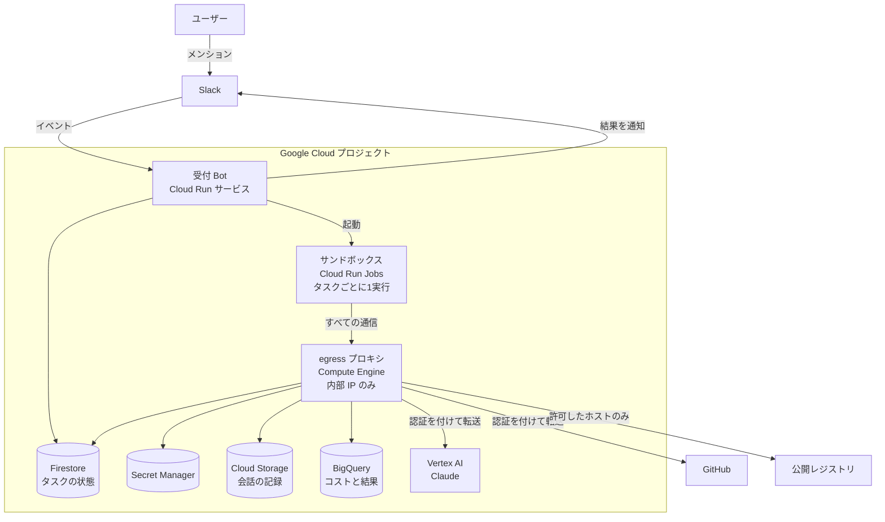
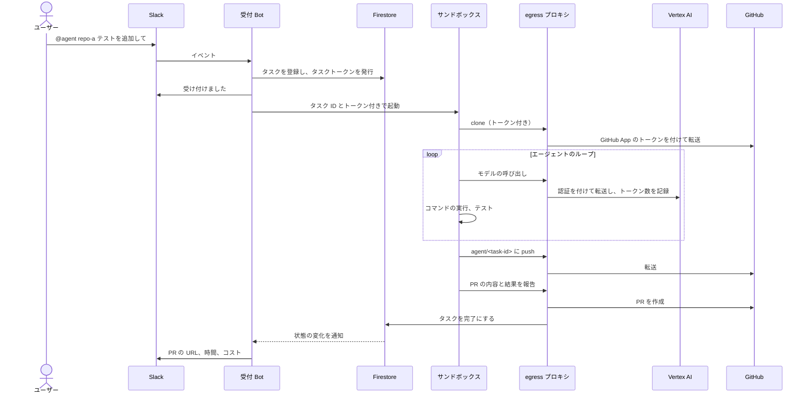

# 社内コーディングエージェント MVP 設計ドキュメント

| 項目 | 内容 |
|---|---|
| ステータス | ドラフト |
| 作成日 | 2026-11-27 |
| 対象 | 社内エンジニアリングチーム（約10人） |
| 実行基盤 | Google Cloud |

## 1. 背景

Stripe の Minions、Spotify の Honk、Ubie の Uvin のように、Slack などから依頼するとバックグラウンドで作業し、PR を返すコーディングエージェントが広まっています。各社の公開事例から、次のことがわかっています。

- 依頼は、普段の仕事の場所（Slack など）から気軽にできることが大事です。
- エージェントが書いたコードは、本番環境や開発者の手元から隔離された場所で実行する必要があります。
- 実行環境に認証情報を置かず、外への通信の出口で付ける設計にすると、乗っ取られても被害を抑えられます（Ubie の egress プロキシ）。
- 利用が増えるとコストも増えるので、成果1件あたりのコストを最初から測っておくべきです（Uber の事例）。

このドキュメントでは、これらの事例を参考に、10人規模のチームで運用できる最小限の構成（MVP）を設計します。

## 2. 目的と非目的

### 目的

- Slack でエージェントに依頼すると、作業結果が GitHub の PR として返ってくる。
- エージェントのコード実行を、タスクごとに使い捨ての隔離環境で行う。
- 実行環境に本物の認証情報を置かない。
- タスクごとのコストと結果を記録し、費用対効果を測れるようにする。
- 少人数で運用できるよう、常時動くクラスタを持たない。

### 非目的（MVP ではやらないこと）

- コード以外の業務（法務、人事など）への対応
- 個人の権限で動くエージェント（OAuth 連携）
- 情報区分によるアクセス制御
- 数時間を超える長時間のタスク、途中からの再開（耐久実行）
- Docker を使うテスト、作業環境の長期保存、ブラウザからのプレビュー
- 複数のモデルの自動的な振り分け
- 社内データの集約（Context Graph など）、自動の改善ループ
- Slack 以外の入口（Jira、Sentry、cron など）

## 3. ユースケース

MVP では、範囲がはっきりした小さなタスクを対象にします。

- 依存ライブラリの更新と、それに伴う修正
- 再現手順がわかっている小さなバグの修正
- 既存コードへのテストの追加
- 小規模なリファクタリング、lint エラーの修正

### 利用の流れ

1. ユーザーが Slack で `@agent <リポジトリ名> <依頼内容>` と書く。
2. エージェントがスレッドに「受け付けました」と返す。
3. エージェントがサンドボックスで作業し、ブランチを push する。
4. PR が作られ、スレッドに PR の URL、かかった時間、コストが投稿される。
5. 人がレビューしてマージする。

## 4. 要件

### 機能要件

| ID | 要件 |
|---|---|
| F1 | Slack のメンションでタスクを受け付け、スレッドに受付・完了・失敗を通知する |
| F2 | 許可リストにあるリポジトリだけを対象にする |
| F3 | タスクごとに新しいサンドボックスを起動し、終わったら破棄する |
| F4 | 作業結果を `agent/<task-id>` ブランチに push し、PR を作る |
| F5 | 同じスレッドへの追加の依頼で、同じブランチに修正を重ねられる |
| F6 | タスクごとに会話の記録、トークン数、コスト、結果を保存する |

F5 は MVP の終盤で対応し、それまでは1つのスレッドにつき1タスクとします。

### 非機能要件

| 観点 | 要件 |
|---|---|
| セキュリティ | サンドボックスに本物の認証情報を置かない。外への通信は許可した宛先だけにする |
| 隔離 | タスク同士、またサンドボックスと社内システムを隔離する |
| 可用性 | 社内ツールとして、営業時間内に使えれば十分。失敗したタスクはやり直せばよい |
| 性能 | 依頼から作業開始まで1分以内を目安にする |
| コスト | 使っていないときの費用をほぼゼロにする。タスクごとに上限を設ける |
| 運用 | 1人が片手間で保守できる。インフラはすべて Terraform で管理する |

## 5. 全体構成

### 参考事例の層との対応

| 層 | MVP の実装 |
|---|---|
| ① 入口 | Slack Bot（受付 Bot） |
| ② 制御 | リポジトリの許可リストと、リポジトリ内の AGENTS.md・Skill |
| ③ 頭脳 | サンドボックス内で動かす既製のハーネス |
| ④ モデル | Vertex AI 経由の Claude（egress プロキシが認証を付ける） |
| ⑤ 手 | Cloud Run Jobs |
| ⑥ 鍵 | egress プロキシ |
| ⑦ コンテキスト | 対象リポジトリと AGENTS.md |
| ⑧ 改善 | 会話の記録と、BigQuery のコスト・結果。毎週、人が見て改善する |

## 6. コンポーネント

### 6.1 受付 Bot（Cloud Run サービス）

Slack とのやりとりと、タスクの管理を担います。

- Slack Bolt でイベントを受け取り、3秒以内に応答する。
- 依頼文からリポジトリ名を取り出し、許可リストと照合する。
- Firestore にタスクを登録し、タスク専用のトークン（後述）を発行する。
- Cloud Run Jobs をタスク ID 付きで起動する（実行時の環境変数の上書きを使う）。
- Firestore のタスクの状態の変化を受けて、Slack のスレッドに通知する。
- 同時に実行するタスクの数を制限する（初期値は3）。

Slack の Bot トークンを持つのはこのサービスだけです。

### 6.2 サンドボックス（Cloud Run Jobs）

エージェントが実際に作業する場所です。

- タスクごとに1回実行し、終わったら破棄する。
- イメージには、ハーネス、git、対象リポジトリで使う言語のツールを入れておく。Cloud Build で毎晩作り直し、Artifact Registry に置く。
- 起動したら、egress プロキシ経由でリポジトリを clone し、ハーネスを実行する。
- 作業の終わりにテストを実行し、`agent/<task-id>` ブランチに push する。
- PR のタイトルと本文を egress プロキシに報告して終了する。PR の作成はプロキシが行う。
- 実行時間の上限は60分とする。

**ハーネス**：Claude Code をヘッドレスモード（`claude -p`）で動かします。次の設定で、Vertex AI への通信を egress プロキシに向け、認証をプロキシに任せられることを検証しました（[付録 A](#付録-a-段階1の検証結果)）。

| 環境変数 | 値 |
|---|---|
| `CLAUDE_CODE_USE_VERTEX` | `1` |
| `CLAUDE_CODE_SKIP_VERTEX_AUTH` | `1`（Google の認証をしない。認証はプロキシが付ける） |
| `ANTHROPIC_VERTEX_BASE_URL` | `http://<proxy>:8080/t/<task-token>/vertex` |
| `ANTHROPIC_VERTEX_PROJECT_ID` | 対象の GCP プロジェクト |
| `CLOUD_ML_REGION` | `global` |
| `CLAUDE_CODE_DISABLE_NONESSENTIAL_TRAFFIC` | `1` |
| `HTTPS_PROXY` | `http://task:<task-token>@<proxy>:8080` |

**サービスアカウント**：サンドボックス専用のサービスアカウントを作り、**IAM ロールを1つも付けません**。Cloud Run の中からはメタデータサーバー経由でサービスアカウントのトークンを取得できてしまうため、権限を持たないアカウントにしておく必要があります。デフォルトのサービスアカウントは使いません。

### 6.3 egress プロキシ（Compute Engine）

サンドボックスからの通信をすべて受け、認証情報を付ける唯一の場所です。

- 内部 IP だけを持つ小さな VM（Container-Optimized OS）で、自作のプロキシをコンテナとして動かす。
- Secret Manager を読めるのは、このプロキシのサービスアカウントだけにする。

宛先ごとの扱いは次のとおりです。

| 宛先 | 方式 | 付ける認証情報 | 制限 |
|---|---|---|---|
| Vertex AI（Claude） | リバースプロキシ | プロキシのサービスアカウントの OAuth トークン | 許可したモデルとリージョンだけ |
| GitHub（git の clone、fetch、push） | リバースプロキシ | GitHub App のインストールトークン | タスクの対象リポジトリだけ |
| PR の作成 | プロキシ独自の API | GitHub App のインストールトークン | タスクの対象リポジトリに1件だけ |
| 進捗と結果の報告 | プロキシ独自の API | なし | Firestore のそのタスクだけに書く |
| 公開レジストリ（npm、PyPI など） | フォワードプロキシ（CONNECT） | なし | 許可リストにあるホストの 443 番ポートだけ。中身は TLS なのでメソッドやパスは制限できない |
| それ以外 | — | — | すべて拒否 |

**タスクトークン**：サンドボックスがプロキシを呼ぶときは、受付 Bot が発行したタスク専用のトークンを付けます。プロキシはこのトークンから、どのタスクの、どのリポジトリへの通信かを判断します。トークンはサンドボックスの中にありますが、次の理由で漏れても被害は小さく抑えられます。

- プロキシ経由でしか使えない（VPC の外からは届かない）。
- 1つのリポジトリにしか使えない。
- タスクが終わると無効になる。

**なぜ Cloud Run ではなく VM か**：サンドボックスの通信をファイアウォールで「この IP の、このポートだけ」に絞るのが一番簡単だからです。Cloud Run のサービスを内部向けにする方法もありますが、Private Service Connect などの設定が増えます。公開レジストリの許可リストは、GCP の Secure Web Proxy に置き換えることもできます。

### 6.4 GitHub の設定

- GitHub App を作り、許可リストのリポジトリだけにインストールする。
- 権限は Contents（読み書き）と Pull requests（読み書き）だけにする。
- Rulesets で次を設定する。
  - GitHub App が push できるのは `agent/*` のブランチだけ
  - デフォルトブランチへのマージには、人による1件以上の承認が必要
  - GitHub App はレビューを承認できない

### 6.5 ネットワーク

- 専用の VPC とサブネットを作る。
- Cloud Run Jobs は Direct VPC egress で、**すべての通信**を VPC に流す。
- VPC ファイアウォールで、サンドボックスからの外向きの通信を、egress プロキシの内部 IP とポート以外すべて拒否する。
- egress プロキシの VM だけが Cloud NAT 経由でインターネットに出られる。

### 6.6 記録とコスト

- 会話の記録（ハーネスの出力）は、egress プロキシ経由で Cloud Storage に保存する。
- タスクごとに次を BigQuery に保存する。
  - 依頼者、リポジトリ、依頼内容
  - 開始・終了時刻、結果（成功、失敗、時間切れ）
  - 入力・出力・キャッシュのトークン数と推定コスト（egress プロキシが Vertex AI の応答から集計する）
  - 作った PR の URL
- PR がマージされたか、あとで revert されたかは、GitHub の Webhook を受付 Bot で受けて記録する。

### 6.7 モデルの設定

- Vertex AI 経由で Claude を使う。請求を GCP にまとめられ、認証は egress プロキシのサービスアカウントで済む。
- **global エンドポイントを使う。** 2026年11月時点で、日本のリージョン（asia-northeast1 など）で Claude を提供しているという記載は確認できなかった。新しいモデル（5 系）は global と、us・eu のマルチリージョンだけで提供されている。社内のコードを扱う MVP では処理する場所の要件がないため、空きの多い global を使う。処理する場所の要件があるデータを扱うときは、us か eu のマルチリージョンを検討する。
- メインのモデルは `claude-sonnet-5-5`、サブエージェントのモデルは `claude-haiku-5-5` を既定にする（`ANTHROPIC_MODEL`、`ANTHROPIC_DEFAULT_HAIKU_MODEL`、`CLAUDE_CODE_SUBAGENT_MODEL`）。egress プロキシでも、許可したモデル以外への通信を拒否する。
- reasoning effort は中程度を既定にする。
- タスクごとにターン数とトークン数の上限を設け、超えたら止めてスレッドに報告する。

## 7. 処理の流れ

## 8. セキュリティ

### 脅威と対策

想定する最大の脅威は、**依頼文、リポジトリ内のファイル、Issue、依存パッケージなどに仕込まれた指示（プロンプトインジェクション）によって、エージェントが意図しない動作をすること**です。

| 脅威 | 対策 |
|---|---|
| 認証情報の盗難 | サンドボックスに本物の認証情報を置かない。サービスアカウントに権限を付けない |
| 外部へのデータの持ち出し | 外への通信を egress プロキシに限り、許可した宛先以外を拒否する |
| 許可していないリポジトリへの書き込み | タスクトークンを対象リポジトリに限る。GitHub App のインストール先を限る |
| 悪意のあるコードのマージ | Rulesets で `agent/*` 以外への push を禁止し、マージに人の承認を必須にする |
| 他のタスクへの影響 | タスクごとに使い捨てのサンドボックスを使う |
| 社内システムへの侵入 | 専用の VPC を使い、社内ネットワークとはつながない |
| コストの暴走 | タスクごとの上限、同時実行数の制限、GCP の予算アラート |

### 残るリスク

- **許可したレジストリ経由の持ち出し**：npm などへの通信は CONNECT のトンネルで許可しています。トンネルの中は TLS なので、プロキシでは GET と publish を区別できず、URL に載せたデータの持ち出しも防げません。publish にはレジストリの認証情報が必要で、サンドボックスはそれを持たないため、MVP ではこのリスクを受け入れます。次の段階で、Artifact Registry のリモートリポジトリ（公開レジストリの読み取り専用のキャッシュ）に切り替え、公開レジストリへの直接の通信をなくします。
- **PR の本文やコードを経由した持ち出し**：エージェントが作る PR に機密情報を書き込むおそれがあります。対象は社内の private リポジトリに限り、レビューで確認します。
- **依頼者の確認**：Slack のワークスペースにいる人なら誰でも依頼できます。MVP では特定のチャンネルとメンバーに限ります。

## 9. コスト

使っていないときにかかるのは、egress プロキシの VM と、わずかなストレージだけです。主な変動費はモデルの利用料です。

- タスクごとの上限（60分、ターン数、トークン数）を設ける。
- GCP の予算アラートを、想定する月額の50%・80%・100%で設定する。
- 毎週、BigQuery で「マージされた PR 1件あたりのコスト」を確認する。

## 10. 成功の指標

| 指標 | 目標の目安（試行開始から1か月） |
|---|---|
| 週間の利用者数 | チームの半数以上 |
| PR のマージ率 | 50% 以上 |
| マージされた PR 1件あたりのコスト | 測定して基準値を決める |
| 依頼から PR までの時間（中央値） | 30分以内 |
| マージ後の revert 率 | 5% 以下 |

目標の数値は仮のものです。最初の2週間のデータを見て見直します。

## 11. 検討した代替案

| 案 | 採用しなかった理由 | 採用を考えるきっかけ |
|---|---|---|
| GKE + Agent Sandbox（gVisor、Kata） | クラスタの運用が10人のチームには重い | Docker を使うテストや、作業環境の長期保存が必要になったとき |
| 外部のサンドボックスサービス（E2B、Modal など） | データとコードが GCP の外に出る。通信の制御を自分たちで設計しにくい | Cloud Run Jobs の起動の遅さや制約が問題になったとき |
| ハーネスをサンドボックスの外で動かす（頭脳と手の分離） | 既製のハーネスをそのまま使えず、作るものが大きく増える | 長時間のタスクや、途中からの再開が必要になったとき |
| 既製のコーディングエージェント（Devin など） | 認証情報と通信の制御を自分たちで設計できない。社内に知見がたまらない | 自前の運用が負担になったとき |
| サンドボックスに認証情報を直接渡す | 乗っ取られたときの被害が大きい | 採用しない |

## 12. 未決事項

| 項目 | 確認すること | 状態 |
|---|---|---|
| ハーネス | Claude Code のヘッドレスモードで、Vertex AI の接続先を egress プロキシに差し替え、認証をプロキシに任せられるか | 確認済み（付録 A） |
| モデルのリージョン | 使いたい Claude のモデルが、使いたいリージョン（東京など）の Vertex AI で提供されているか | 確認済み。日本のリージョンでの提供は確認できず、global を使う（6.7） |
| モデルの有効化とクォータ | プロジェクトで Claude のモデルを有効にし、実際に応答が返るか | **未完了**。Model Garden での有効化と利用規約への同意が必要 |
| git の通信 | git の `url.<base>.insteadOf` で、clone と push をプロキシ経由にできるか | clone と fetch は確認済み。push は GitHub App の作成後に確認する |
| Cloud Run Jobs | タスクの起動時間、イメージの大きさによる影響、1回の実行時間の上限 | 未確認 |
| 対象リポジトリ | 最初に許可するリポジトリと、テストの実行方法 | 未定 |
| Slack | 依頼を受け付けるチャンネルとメンバー | 未定 |

## 13. 進め方

| 段階 | 内容 | 完了の条件 |
|---|---|---|
| 1. 検証 | 未決事項のうち、ハーネスとモデルと git の通信を検証する | 手元のプロキシ経由で、ハーネスが PR を作れる |
| 2. サンドボックス | Cloud Run Jobs でハーネスを動かす | 手動で起動すると PR ができる |
| 3. 鍵と通信の制限 | egress プロキシ、VPC、ファイアウォール、GitHub App と Rulesets を整える | サンドボックスに本物の認証情報がなく、許可していない宛先に届かない |
| 4. Slack Bot | 受付 Bot と Firestore を作る | Slack から依頼して PR が返る |
| 5. 記録 | Cloud Storage と BigQuery への記録、完了時のコスト表示 | 指標を BigQuery で集計できる |
| 6. チームで試す | 2〜3人から始め、チーム全体に広げる | 成功の指標を2週間分測れる |

段階3を段階4より先に進めます。Slack から誰でも呼べるようになる前に、認証情報と通信の制限を固めておくためです。

### MVP の後に足すもの

| 段階 | 足すもの |
|---|---|
| 第2段階 | Jira や Sentry からの起動、同じスレッドでの追加の依頼、コストのダッシュボード、セッションの自動分析 |
| 第3段階 | GKE Agent Sandbox への移行、頭脳と手の分離、耐久実行、個人の権限で動くエージェント |
| 第4段階 | 社内データの集約と MCP ゲートウェイ、自動の改善ループ、複数モデルの振り分け |

## 付録 A. 段階1の検証結果

2026-11-27 に手元の Mac で検証しました。egress プロキシの試作は [../egress-proxy](../egress-proxy) にあります。

### Claude Code → egress プロキシ → Vertex AI

- Claude Code 2.1.236 を、ユーザーの設定から切り離した設定ディレクトリで、[6.2](#62-サンドボックスcloud-run-jobs) の環境変数を付けてヘッドレスモードで実行した。
- Claude Code はモデルの呼び出しを `ANTHROPIC_VERTEX_BASE_URL` に送り、プロキシが Google のアクセストークンを付けて global エンドポイントの `streamRawPredict` に転送した。
- Vertex AI からはクォータ超過（429）が返った。認証が通らなければ 401 か 403 になるので、**プロキシで付けた認証は受け入れられている**。429 は、このプロジェクトで Claude のモデルがまだ有効になっていないためと考えられる（Model Garden の一覧には表示され、利用申請の項目がある）。
- `CLAUDE_CODE_DISABLE_NONESSENTIAL_TRAFFIC=1` と `HTTPS_PROXY` を設定した状態で、Claude Code からモデルの呼び出し以外の通信（CONNECT）は発生しなかった。

### git → egress プロキシ → GitHub

- `url.<base>.insteadOf` で、公開リポジトリの clone と `ls-remote` がプロキシ経由で成功した。
- タスクに許可していないリポジトリの clone は、プロキシが 403 で拒否した。
- 認証情報（GitHub App のトークン）を付ける処理は単体テストで確認した。実際の push は GitHub App を作ってから確認する。

### 公開レジストリへの CONNECT

- 許可したホスト（registry.npmjs.org）への通信は成功し、許可していないホスト（example.com）への通信は拒否された。

### 確認できたこと以外の発見

- Vertex AI の global エンドポイントでは、v1 の `rawPredict` が 404（HTML のエラーページ）になり、`streamRawPredict` と v1beta1 の `rawPredict` は API に届いた。Claude Code は `streamRawPredict` を使うので MVP には影響しない。
- CONNECT ではトンネルの中身を見られないため、レジストリへの通信を読み取りだけに限ることはできない（[8. セキュリティ](#8-セキュリティ) の残るリスクに反映した）。

### Pi → egress プロキシ → Vertex AI（2026-11-28 追加）

ハーネスの候補として、OSS（MIT）の Pi（`@earendil-works/pi-coding-agent` 1.6.1）を同じ条件で試した。

- Pi は Vertex AI の Claude に直接は対応していない。そこで、Pi の `models.json` で接続先（`baseUrl`）をプロキシに向け、プロキシに次の2つの経路を足した。
  - Anthropic Messages API の形（`/v1/messages`）を受けて、Vertex AI の Claude の形に付け替える経路。
  - Gemini API の形を受けて、Vertex AI の Gemini に付け替える経路。
- Pi が送る鍵（`x-api-key`、`x-goog-api-key`）はダミーで、プロキシが捨てて自分のトークンを付ける。**サンドボックスに鍵を置かない原則は保てる。**
- Gemini（`gemini-2.5-flash`）で、プロキシ経由で clone したリポジトリに「README を要約したファイルを作る」タスクを実行し、成功した。
  - モデルの呼び出しは6回。プロキシのログにトークン数（キャッシュを含む）が出た。
- Claude（`claude-haiku-4-5`）では、Claude Code と同じくクォータ超過（429）まで届いた。
- `PI_OFFLINE=1` と `HTTPS_PROXY` を設定した状態で、モデルの呼び出しと git 以外の通信は発生しなかった。

### 残っている作業

1. プロジェクトで Claude のモデル（`claude-sonnet-5-5`、`claude-haiku-5-5`）を Model Garden で有効にする。利用規約への同意が必要なので、プロジェクトの管理者が行う。
2. 有効にしたあと、同じ手順で実際に応答が返ることと、プロキシのログにトークン数が出ることを確かめる。
3. GitHub App を作り、push と PR の作成を確かめる。

## 14. 参考資料

- [Software Factoryの先へ：全社の仕事をAI-NativeにするUbieの内製クラウドエージェント基盤（Ubie）](https://zenn.dev/ubie_dev/articles/45501469c9c044)
- [一億総業務改善を支える社内AIエージェント基盤の要諦（Ubie）](https://speakerdeck.com/yukukotani/key-point-of-internal-ai-agent-platform)
- [Running a Software Factory Efficiently at Uber Scale（Uber）](https://www.uber.com/us/en/blog/efficient-software-factory/)
